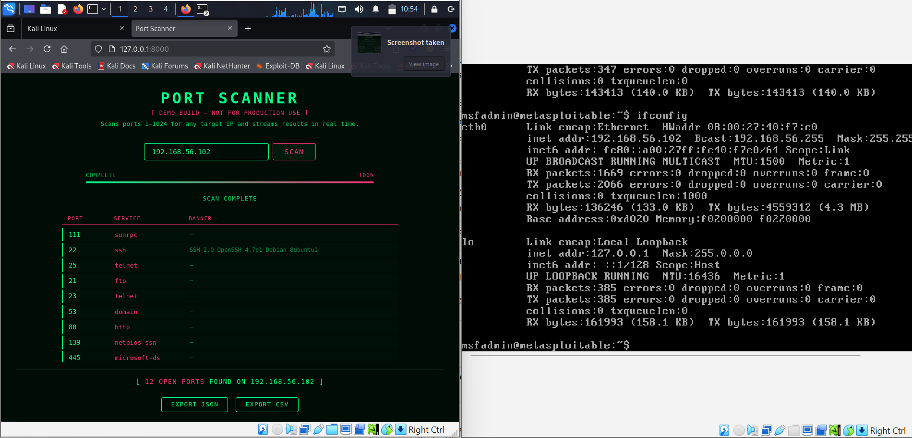
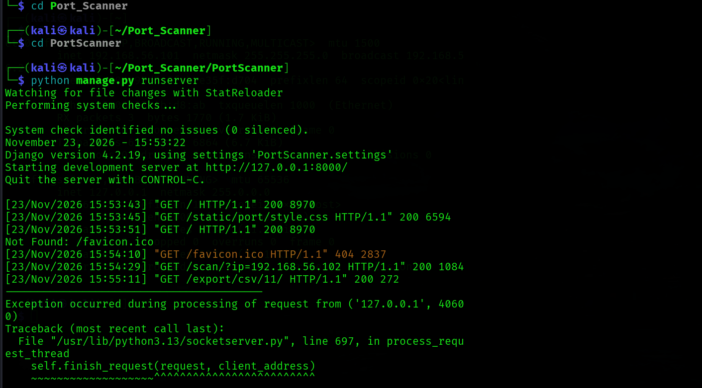

# Port Scanner

A web-based port scanner built with **Django** and **Python** that scans TCP ports (1–1024) on a target IP or host, streams live results in real time using Server-Sent Events (SSE), identifies services and banners, stores scan history in the database, and exports reports in **JSON** and **CSV** formats.

> **Disclaimer:** For educational, auditing, and authorized network diagnostics only. Do not scan networks or hosts without explicit permission.

## Demo / Screenshot




## About the Demo

The screenshot shows a demo of how my Kali machine is scanning the ports on the Metasploitable machine. To scan the target, both machines should be on the same network. 


## Features

- **Multi-Threaded Port Scanning:** Scans ports `1` to `1024` concurrently using Python threads.
- **Real-Time Streaming:** Streams open port discoveries and scan summaries to the dashboard via `StreamingHttpResponse` (SSE).
- **Service & Banner Grabbing:** Detects common services via `socket.getservbyport()` and grabs basic HTTP/service banners.
- **Scan History:** Saves scan runs (`ScanHistory`) and individual port findings (`PortResult`) to the Django database and displays recent scans on the dashboard.
- **JSON & CSV Exports:** Downloadable scan reports per scan ID (`/export/json/<scan_id>/` and `/export/csv/<scan_id>/`).

## Tech Stack

- **Backend:** Python, Django
- **Networking & Concurrency:** `socket`, `threading`
- **Streaming & Exports:** Server-Sent Events (`StreamingHttpResponse`), `json`, `csv`
- **Frontend:** HTML dashboard (`index.html`), CSS (`style.css`)

## Setup & Installation

1. **Clone the repository**
   ```bash
   git clone [https://github.com/296apurva/PortScanner.git](https://github.com/296apurva/PortScanner.git)
   cd PortScanner
